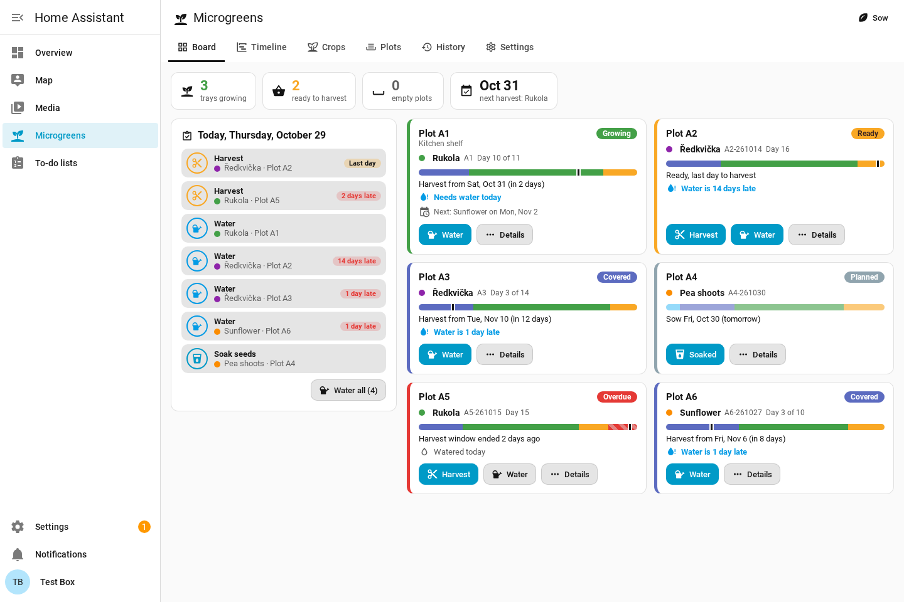
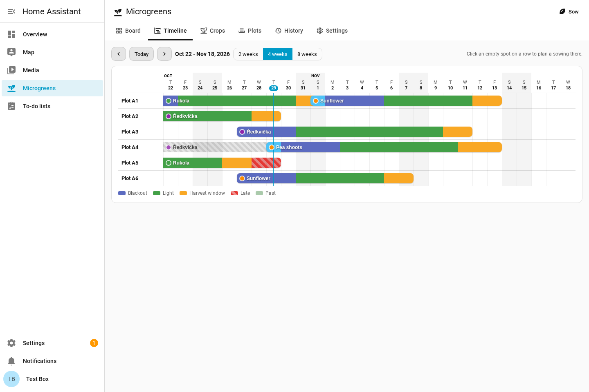
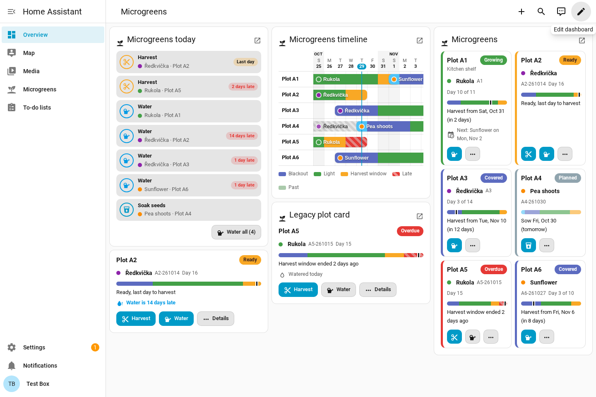

# Microgreens for Home Assistant

Plan, grow and harvest microgreen trays from Home Assistant. Keep track of which tray is in blackout, which needs water, and which is ready to cut, and get one short message a day telling you what to do.



## What you get

- **A sidebar panel** with six tabs:
  - **Board**: today's tasks and one tile per plot (stage bar, next step, one-tap actions).
  - **Timeline**: every tray as a bar through blackout, light and its harvest window, past and planned. Click an empty spot to plan a sowing there.
  - **Crops**: your varieties with their stage lengths, watering interval and yield statistics.
  - **Plots**: the trays or shelf positions you grow in.
  - **History**: harvests and failures, with yield, rating and per-crop averages.
  - **Settings** (administrators): notifications and backup.
- **A dashboard card** with a visual editor: board, today's tasks, timeline, or one plot.
- **Notifications**: a morning digest, an evening reminder if something is still open, a "Watered all" button on the companion app, and an optional Home Assistant notification that clears itself.
- **A to-do list** of today's tasks. Checking one off does it.
- **Entities and services** for automations.



## How a tray moves through its stages

| Stage | Meaning | Status |
|---|---|---|
| Soak | Seeds soaking before sowing (optional; you are reminded the day before) | Planned |
| Blackout | Covered and dark until the shoots push up | Covered |
| Light | Uncovered, greening | Growing |
| Harvest window | Good to cut for a few days | Ready |
| Late | Past the window, still on the plot | Overdue |

A crop defines the lengths: blackout days, light days, harvest window days, water every N days and soak hours. Each tray keeps its own copy, so editing a crop never moves trays already growing. Uncovering is recorded when you do it; the harvest dates stay anchored to the sowing date. Use **+1 day / -1 day** on a tray when it needs longer or is early.

A sowing with a date in the future is a **plan**: it shows on the timeline, reminds you to soak and sow, and counts from the day you confirm it.

## Installation

1. HACS > three dots > **Custom repositories** > `https://github.com/3dg1luk43/ha-microgreens`, category **Integration**.
2. Install **Microgreens** and restart Home Assistant.
3. **Settings > Devices & services > Add integration > Microgreens.**
4. Open **Microgreens** in the sidebar.

A fresh install starts with six plots (A1 to A6) and a few common crops. Requires Home Assistant 2026.2 or newer.

### Upgrading from 0.1.x

0.2.0 is a rebuild under a new domain, `ha_microgreens` (0.1.x was `microgreens`).

1. Install 0.2.0 and add the integration as above. Your plots, crops and trays are imported from the old storage file, which is left untouched, and the old notify target and summary time carry over.
2. A repair (**Settings > System > Repairs**) offers to delete the old entry. Then remove the old download (`custom_components/microgreens`) in HACS or by hand, and restart.
3. Old dashboard cards keep working: `custom:microgreens-card` shows the board and `custom:microgreens-plot-card` one plot. The card now loads by itself; the old Lovelace resources are removed.

The calendar entity is gone; the timeline replaces it.

## Notifications

Settings tab (or **Configure** on the integration):

- **Send to**: any notify service or notify entity. Companion app targets (`notify.mobile_app_...`) also get the action buttons and open the panel when tapped.
- **Morning digest** (default 08:00): everything due today, grouped: harvest, uncover, water, sow, soak. Nothing is sent on a day with no tasks.
- **Evening reminder** (default 19:00): only if something is still open; a harvest only on its last day of the window or once late.
- **Home Assistant notification**: the digest in the sidebar too, updated as you tick things off and dismissed when all is done.
- **Phone action buttons**: "Watered all" waters every tray that is due.

Watering is only ever marked done by you (panel, card, button, to-do list, service or the phone button), never by a notification being sent.

## Dashboard card

Add it from the card picker (search "Microgreens") and use the visual editor, or in YAML:

```yaml
type: custom:ha-microgreens-card
view: board        # board | tasks | timeline | plot
plots: [A1, A2]    # optional: only these plots
plot_id: A1        # view: plot
title: Kitchen shelf
days: 14           # view: timeline
show_tasks: true   # view: board
compact: false     # view: board / plot
```



## Entities

Per plot (one device per plot):

| Entity | Example | State |
|---|---|---|
| Status | `sensor.plot_a1_status` | `empty`, `planned`, `covered`, `growing`, `ready`, `overdue`; attributes: crop, sowing, uncover and harvest dates, day, water due, next plan |
| Harvest date | `sensor.plot_a1_harvest_date` | first day of the harvest window |
| Progress | `sensor.plot_a1_progress` | % from sowing to harvest |
| Needs water | `binary_sensor.plot_a1_needs_water` | on when watering is due |
| Watered | `button.plot_a1_watered` | mark watered |

Hub (**Microgreens** device): `sensor.microgreens_tasks_today` (count, task list attribute), `sensor.microgreens_ready_to_harvest`, `binary_sensor.microgreens_watering_due`, `button.microgreens_water_all_due`, `todo.microgreens_tasks`.

## Services

Each takes `plot` (ID or name, for example `A1`) or `device_id` (the plot's device) and works on that plot's current tray.

| Service | Fields | Does |
|---|---|---|
| `ha_microgreens.sow` | `crop`, `date`, `label`, `notes` | Sow (date today or earlier) or plan (later date). Without `crop`, confirms the plot's planned sowing. |
| `ha_microgreens.water` | | Mark watered. Without a plot: every tray that is due. |
| `ha_microgreens.uncover` | | Record the end of the blackout. |
| `ha_microgreens.harvest` | `yield_grams`, `rating`, `notes` | Harvest into the history. |
| `ha_microgreens.discard` | `reason`, `notes` | Failed tray to the history, or cancel a plan. |
| `ha_microgreens.shift` | `days` | Move a tray's harvest (or a plan's sowing) by days. |
| `ha_microgreens.send_digest` | | Send today's digest now. |
| `ha_microgreens.get_tasks` | | Returns today's tasks (response data). |

Example: a button on the shelf (any Zigbee button) that waters everything due.

```yaml
automation:
  - alias: Shelf button waters the microgreens
    triggers:
      - trigger: state
        entity_id: event.shelf_button_action
    actions:
      - action: ha_microgreens.water
```

Example: send the digest when you come home instead of at a fixed time (turn the morning digest off in Settings).

```yaml
automation:
  - alias: Microgreens digest on arrival
    triggers:
      - trigger: zone
        entity_id: person.me
        zone: zone.home
        event: enter
    actions:
      - action: ha_microgreens.send_digest
```

## Backup

Settings > Backup exports plots, crops, trays and history to a JSON file and imports one back (replacing everything). Home Assistant backups include the data too (`.storage/ha_microgreens`).

## Troubleshooting

- **The panel or card does not appear**: restart Home Assistant after installing, then reload the browser (the files are versioned, so one reload is enough). Diagnostics (on the integration page) show whether the panel and card were registered.
- **No notifications**: check the target in Settings and use **Send test**. Nothing is sent on a day with no tasks; **Send digest now** says so.
- **"Only an administrator can change this"**: crops, plots, settings and backups need an administrator; everyone can sow, water, uncover and harvest.

## Development

```bash
python -m pytest                     # the suite, inside a real Home Assistant (tools in requirements-test.txt)
devtools/release_check.sh            # what CI runs before a release
cd devtools/testbox && ./up.sh --fresh --legacy && python3 hactl.py setup   # a disposable real HA on :8324
PLAYWRIGHT=/path/to/node_modules/playwright node devtools/screenshots.cjs    # panel and card screenshots from the box
```

See [CLAUDE.md](CLAUDE.md) for the rules and traps, and [CHANGELOG.md](CHANGELOG.md).

Issues and ideas: [github.com/3dg1luk43/ha-microgreens/issues](https://github.com/3dg1luk43/ha-microgreens/issues). License: AGPL-3.0-or-later.
